<p align="center">
  
</p>

# Awesome Human Mesh Recovery & 3D Pose Estimation 🏃‍♂️✨

<p align="center">
  <a href="https://github.com/ishandutta2007/Awesome-Human-Mesh-Recovery-3D-Pose-Estimation/stargazers"></a>
  <a href="https://github.com/ishandutta2007/Awesome-Human-Mesh-Recovery-3D-Pose-Estimation/network/members"></a>
  <a href="https://github.com/ishandutta2007/Awesome-Human-Mesh-Recovery-3D-Pose-Estimation/pulls"></a>
  <a href="https://github.com/sindresorhus/awesome"></a>
</p>

> 🌟 **A curated list of top human mesh recovery (HMR), 3D human pose estimation (HPE), markerless motion capture (MoCap), SMPL / SMPL-X / MHR body reconstruction, and 3D character animation pipelines.** Featuring commercial cloud SaaS platforms alongside leading open-source models ranked by community adoption.

---

## 📑 Table of Contents
- [🌐 Sector Overview & Market Dynamics](#-sector-overview--market-dynamics)
- [☁️ SaaS / Hosted Commercial Platforms](#️-saas--hosted-commercial-platforms)
- [🔓 Open-Source Equivalents & Frameworks](#-open-source-equivalents--frameworks)
  - [🧍 Monocular & Video Human Mesh Recovery (SMPL / SMPL-X)](#-monocular--video-human-mesh-recovery-smpl--smpl-x)
  - [⚡ Markerless Multi-View & Monocular 3D Motion Capture](#-markerless-multi-view--monocular-3d-motion-capture)
  - [🦴 2D & 3D Skeleton Pose Estimation Frameworks](#-2d--3d-skeleton-pose-estimation-frameworks)
  - [🖐️ Whole-Body, Hand & Face Mesh Reconstruction](#️-whole-body-hand--face-mesh-reconstruction)
  - [🎬 3D Animation, Retargeting & Blender DCC Integrations](#-3d-animation-retargeting--blender-dcc-integrations)
- [🤝 Contributing](#-contributing)
- [📄 License](#-license)

---

## 🌐 Sector Overview & Market Dynamics

The global **3D Motion Capture and Markerless Human Pose Estimation** market is valued at approximately **$320M – $510M**, with the dedicated markerless sub-segment growing at an accelerated **~17.4% CAGR** toward **$390M+** by the mid-2030s.

The market structure is **moderately fragmented**: while enterprise entertainment, biomechanics, and clinical gait sectors retain sticky legacy contracts with optical/inertial hardware incumbents (Vicon, Qualisys, Movella), rapid breakthroughs in monocular vision transformers (ViT, SMPL-X, MHR) have democratized pose lifting. This has triggered an influx of specialized generative AI SaaS startups and robust open-source foundation models that challenge high-cost hardware moats.

---

## ☁️ SaaS / Hosted Commercial Platforms

Commercial AI motion capture studios, browser-based video-to-3D animation platforms, and automated character rigging services.

> **Sorted by Company Scale / Valuation (Descending):**

| Platform | Core Capabilities | Starting Tier Pricing | Free Tier / Trial Limits | Company Scale & Valuation |
| :--- | :--- | :--- | :--- | :--- |
| **[Mixamo (Adobe)](https://mixamo.com)** 🎨 | Automated cloud 3D character rigging, skinning, and motion-captured animation library. | **$0.00 / mo** (Free with Adobe ID) | **Unlimited Free Forever** (Full access, unlimited non-commercial & commercial exports, no paid CC required). | **$90B+ Market Cap** (Parent Adobe; acquired Mixamo for ~$11.9M+ venture basis). |
| **[Autodesk Flow Studio](https://wonderdynamics.com)** 🎥 *(formerly Wonder Dynamics)* | Cloud AI platform that animates, lights, and composites CG characters into live-action scenes from single-camera video. | **$7.00 / mo** (Lite plan billed annually) | **300 credits/month Free Forever** (AI MoCap & 3D Canvas access; export resolution & character-pass limits apply). | **$60B+ Market Cap** (Acquired by Autodesk in May 2024; previously venture-backed by Epic Games & Samsung). |
| **[ActorCore (Reallusion)](https://actorcore.reallusion.com)** 🎭 | Cloud-hosted 3D character asset store, optical mocap library, and AccuRIG auto-rigging engine. | **$9.90 / pack** (or $29/mo software tiers) | **Free Forever AccuRIG tool** (Unlimited auto-rigging; sample animations & 3D character models provided free). | **$100M+ Valuation est.** (Self-sustained profitable animation software creator of iClone & Character Creator). |
| **[Cascadeur Cloud & AI](https://cascadeur.com)** 🤸 | Physics-based 3D keyframe animation software with AI-assisted AutoPosing, AutoPhysics, and rigging. | **$19.00 / mo** (or $99/yr Indie license) | **Free Forever Non-Commercial Plan** (Full core physics/rigging tools; export locked exclusively to `.casc` format). | **$50M+ Valuation est.** (Developed by Nekki; millions of registered animators worldwide). |
| **[Rokoko Studio & Vision](https://rokoko.com)** 🎽 | Hybrid mocap suite combining inertial sensor suits, Smartgloves, and dual-cam AI video MoCap (Rokoko Vision). | **$20.00 / mo** (Plus plan billed annually) | **Free Forever Starter + 7-Day Pro Trial** (Starter gives mocap recording & FBX export; 600s/mo Rokoko Vision cap). | **$40M – $80M Valuation** (~$14.9M total funding raised from North-East Venture & Naver Z). |
| **[Move.ai (Move One)](https://move.ai)** 📱 | High-fidelity markerless motion capture converting single-camera iPhone video and multi-camera arrays into 3D FBX/USD. | **$18.00 / mo** (Move One Starter, 60 credits/mo) | **30 Free Credits One-Time** (Non-expiring trial, max 30s per video clip, single-person tracking). | **$25M – $35M Valuation est.** (Seed/Series A venture funding backed by Playfair Capital & Animoca Brands). |
| **[RADiCAL Motion](https://radicalmotion.com)** 📡 | Real-time markerless 3D human motion capture and scene reconstruction via browser canvas and mobile devices. | **$6.00 / mo** (Starter subscription) | **24 hours/year Motion Playtime Free Forever** (Metered export allowances; capped at ~3 FBX exports & streams/mo). | **$15M – $25M Valuation est.** (Backed by strategic corporate investment from Autodesk). |
| **[Kinetix](https://kinetix.tech)** 🕹️ | Cloud AI motion extraction and user-generated 3D emote creation engine for virtual worlds and games. | **$15.00 / mo** (Creator tier) | **Free Forever Freemium Tier** (15 free emote exports/mo; community library access; standard resolution export). | **$15M – $20M Valuation** (~$11.6M funding raised led by The Sandbox & Entrepreneur First). |
| **[Plask](https://plask.ai)** 🎬 | Browser-based AI motion capture editor enabling rapid video-to-keyframe extraction, retargeting, and cleanup. | **$28.00 / mo** (Pro plan) | **15 seconds/day Free Forever MoCap** (Includes 1 GB cloud storage; non-commercial standard exports). | **$10M – $15M Valuation** (~$2.56M Pre-Series A funding led by Smilegate & Naver D2SF). |
| **[DeepMotion (Animate 3D)](https://deepmotion.com)** 🤖 | Cloud AI markerless mocap platform extracting full-body, hand, and facial motion with physics simulation from 2D video. | **$9.00 / mo** (Starter plan with commercial rights) | **25 – 60 Free Credits/Month Free Forever** (Max 20s per clip, non-commercial, earnable bonus credits via labeling). | **$8M – $12M Valuation est.** (~$2.2M funding raised from Samsung Venture Investment & Bandai Namco). |

---

## 🔓 Open-Source Equivalents & Frameworks

State-of-the-art open-source software (FOSS), deep learning foundation models, real-time pose lifting pipelines, and DCC animation integrations.

> **Sorted by GitHub Stars (Descending) within each category:**

### 🧍 Monocular & Video Human Mesh Recovery (SMPL / SMPL-X)

Frameworks that recover 3D human body meshes (SMPL, SMPL-X, MHR) from single RGB images or video streams.

1. **[VIBE](https://github.com/mkocabas/VIBE)** [](https://github.com/mkocabas/VIBE/stargazers) 🌟
   * *Description:* Video Inference for Body Pose and Shape Estimation using adversarial temporal learning to predict kinematically plausible 3D SMPL sequences.
2. **[HMR (End-to-end Recovery)](https://github.com/akanazawa/hmr)** [](https://github.com/akanazawa/hmr/stargazers) 🌟
   * *Description:* Seminal deep learning framework for end-to-end recovery of 3D human shape and pose from a single monocular image.
3. **[4D-Humans (HMR 2.0)](https://github.com/shubham-goel/4D-Humans)** [](https://github.com/shubham-goel/4D-Humans/stargazers) 🌟
   * *Description:* State-of-the-art transformer-based 3D human mesh recovery and tracking system from monocular video in dynamic scenes.
4. **[ROMP](https://github.com/Arthur151/ROMP)** [](https://github.com/Arthur151/ROMP/stargazers) 🌟
   * *Description:* Monocular, one-stage, multi-person 3D mesh regression network capable of real-time multi-human body estimation.
5. **[WHAM](https://github.com/yohanshin/WHAM)** [](https://github.com/yohanshin/WHAM/stargazers) 🌟
   * *Description:* World-grounded humans with accurate 3D motion estimation from moving monocular cameras without foot-sliding artifacts.
6. **[TRAM](https://github.com/yufu-wang/tram)** [](https://github.com/yufu-wang/tram/stargazers) 🌟
   * *Description:* Global trajectory-aware human mesh recovery coupling dual-masking SLAM with dynamic video transformer pose lifting.
7. **[InstantHMR](https://github.com/Naturalpad-studio/InstantHMR)** [](https://github.com/Naturalpad-studio/InstantHMR/stargazers) 🌟
   * *Description:* Ultra-fast real-time human mesh recovery pipeline (Meta MHR rig) running up to ~120+ FPS on edge mobile NPUs and GPUs.
8. **[TokenHMR](https://github.com/saidwivedi/TokenHMR)** [](https://github.com/saidwivedi/TokenHMR/stargazers) 🌟
   * *Description:* Tokenized pose representation framework (CVPR 2024) advancing 3D mesh recovery with threshold-adaptive loss scaling.
9. **[CameraHMR](https://github.com/pixelite1201/CameraHMR)** [](https://github.com/pixelite1201/CameraHMR/stargazers) 🌟
   * *Description:* Perspective-aligned human mesh recovery estimating camera field-of-view and dense surface keypoints to fix perspective distortion.

---

### ⚡ Markerless Multi-View & Monocular 3D Motion Capture

Markerless kinematics, multi-camera calibration, biomechanics, and skeletal tracking suites.

1. **[FreeMoCap](https://github.com/FreeMoCap/freemocap)** [](https://github.com/FreeMoCap/freemocap/stargazers) 🌟
   * *Description:* Hardware- and software-agnostic open-source markerless motion capture system built for research, indie animation, and biomechanics.
2. **[EasyMocap](https://github.com/zju3dv/EasyMocap)** [](https://github.com/zju3dv/EasyMocap/stargazers) 🌟
   * *Description:* Zhejiang University's comprehensive markerless motion capture toolbox supporting multi-view and single-view SMPL/SMPL-X reconstruction.
3. **[MotionBERT](https://github.com/Walter0807/MotionBERT)** [](https://github.com/Walter0807/MotionBERT/stargazers) 🌟
   * *Description:* Unified pretraining framework for 3D human motion representation, recovering 3D skeletons, meshes, and action kinematics from 2D poses.
4. **[Pose2Sim](https://github.com/perfanalytics/pose2sim)** [](https://github.com/perfanalytics/pose2sim/stargazers) 🌟
   * *Description:* Open-source Python workflow connecting 2D keypoint estimators with OpenSim for clinical-grade markerless 3D kinematics.
5. **[Fairmotion](https://github.com/facebookresearch/fairmotion)** [](https://github.com/facebookresearch/fairmotion/stargazers) 🌟
   * *Description:* Meta Research's library to interface with, process, and visualize 3D human motion data using deep neural networks.
6. **[OpenCap](https://github.com/stanfordnmbl/opencap-core)** [](https://github.com/stanfordnmbl/opencap-core/stargazers) 🌟
   * *Description:* Stanford University's open-source dual-smartphone 3D biomechanics and musculoskeletal movement capture framework.

---

### 🦴 2D & 3D Skeleton Pose Estimation Frameworks

Real-time keypoint extractors, vision transformers, and 2D-to-3D pose lifting neural backbones.

1. **[Ultralytics YOLO11 / YOLOv8 Pose](https://github.com/ultralytics/ultralytics)** [](https://github.com/ultralytics/ultralytics/stargazers) 🌟
   * *Description:* Industry-standard ultra-fast real-time keypoint detection deployable across edge devices, mobile, ONNX, and TensorRT.
2. **[MediaPipe Pose Landmarker](https://github.com/google-ai-edge/mediapipe)** [](https://github.com/google-ai-edge/mediapipe/stargazers) 🌟
   * *Description:* Google's cross-platform framework outputting 33 full-body 3D skeletal landmarks in real-time on CPU, Web, and mobile.
3. **[OpenPose](https://github.com/CMU-Perceptual-Computing-Lab/openpose)** [](https://github.com/CMU-Perceptual-Computing-Lab/openpose/stargazers) 🌟
   * *Description:* CMU's pioneering multi-person real-time keypoint detection library for body, foot, hand, and facial landmark estimation.
4. **[AlphaPose](https://github.com/MVIG-SJTU/AlphaPose)** [](https://github.com/MVIG-SJTU/AlphaPose/stargazers) 🌟
   * *Description:* High-accuracy real-time multi-person whole-body pose estimation and tracking framework supporting 2D and 3D pose lifting.
5. **[MMPose](https://github.com/open-mmlab/mmpose)** [](https://github.com/open-mmlab/mmpose/stargazers) 🌟
   * *Description:* OpenMMLab's modular PyTorch toolbox supporting RTMPose, 2D/3D human pose estimation, and whole-body keypoint tracking.
6. **[DWPose](https://github.com/IDEA-Research/DWPose)** [](https://github.com/IDEA-Research/DWPose/stargazers) 🌟
   * *Description:* Effective two-stage distilled whole-body pose estimator achieving top accuracy for body, hand, and face keypoints.
7. **[ViTPose](https://github.com/ViTAE-Transformer/ViTPose)** [](https://github.com/ViTAE-Transformer/ViTPose/stargazers) 🌟
   * *Description:* Scalable Vision Transformer baseline achieving state-of-the-art accuracy on MS COCO and whole-body pose estimation benchmarks.
8. **[MotionAGFormer](https://github.com/TaatiTeam/MotionAGFormer)** [](https://github.com/TaatiTeam/MotionAGFormer/stargazers) 🌟
   * *Description:* Attention-GCNFormer neural network fusing transformer self-attention with graph convolutions for 2D-to-3D pose lifting.

---

### 🖐️ Whole-Body, Hand & Face Mesh Reconstruction

Expressive foundation models capturing full body articulation, finger gestures, and emotional facial geometry.

1. **[SMPL-X](https://github.com/vchoutas/smplx)** [](https://github.com/vchoutas/smplx/stargazers) 🌟
   * *Description:* Expressive 3D human body model integrating body pose, articulated hands (MANO), and facial geometry (FLAME) into a unified mesh.
2. **[DECA](https://github.com/YadiraF/DECA)** [](https://github.com/YadiraF/DECA/stargazers) 🌟
   * *Description:* Detailed Expression Capture and Animation reconstructing 3D head meshes with animatable UV displacement and wrinkles.
3. **[FrankMocap](https://github.com/facebookresearch/frankmocap)** [](https://github.com/facebookresearch/frankmocap/stargazers) 🌟
   * *Description:* Meta Research's fast 3D multi-camera whole-body motion capture system estimating 3D hands and body simultaneously.
4. **[SMPLer-X](https://github.com/MotrixLab/SMPLer-X)** [](https://github.com/MotrixLab/SMPLer-X/stargazers) 🌟
   * *Description:* Foundation model for expressive whole-body 3D human pose and shape estimation trained across large-scale synthetic & real datasets.
5. **[HaMeR](https://github.com/geopavlakos/hamer)** [](https://github.com/geopavlakos/hamer/stargazers) 🌟
   * *Description:* Robust transformer-based 3D hand mesh recovery model from monocular RGB images under severe occlusions.
6. **[OSX](https://github.com/IDEA-Research/OSX)** [](https://github.com/IDEA-Research/OSX/stargazers) 🌟
   * *Description:* One-stage expressive human pose and shape estimation network jointly predicting 3D body, hands, and facial geometry.
7. **[PIXIE](https://github.com/yfeng95/PIXIE)** [](https://github.com/yfeng95/PIXIE/stargazers) 🌟
   * *Description:* Collaborative regression of expressive bodies, hands, and faces with moderating networks from monocular RGB images.

---

### 🎬 3D Animation, Retargeting & Blender DCC Integrations

Blender plugins, retargeting utilities, and digital content creation (DCC) pipelines bridging mocap to production rigs.

1. **[BlendArMocap](https://github.com/cgtinker/BlendArMocap)** [](https://github.com/cgtinker/BlendArMocap/stargazers) 🌟
   * *Description:* Open-source Blender add-on enabling markerless motion capture directly from webcam video mapped onto Rigify rigs.
2. **[Rokoko Studio Live for Blender](https://github.com/Rokoko/rokoko-studio-live-blender)** [](https://github.com/Rokoko/rokoko-studio-live-blender/stargazers) 🌟
   * *Description:* Blender plugin for live motion streaming and automated bone retargeting between arbitrary mocap armatures and custom rigs.
3. **[SMPL Blender Add-on](https://github.com/Meshcapade/SMPL_blender_addon)** [](https://github.com/Meshcapade/SMPL_blender_addon/stargazers) 🌟
   * *Description:* Official Meshcapade add-on for Blender to import, shape, pose, and export SMPL, SMPL-H, and SMPL-X body models.

---

## 🤝 Contributing

Contributions are warmly welcomed! Help keep this repository comprehensive and up-to-date with the latest advances in 3D computer vision and generative motion capture.

1. 🍴 **Fork** this repository.
2. 🌿 Create a descriptive feature branch: `git checkout -b feature/add-new-hmr-model`.
3. 📝 Add your project under the appropriate category in alphabetical or star-ranked order with its official GitHub repo badge:
   ```markdown
   * **[Project-Name](repo-url)** [](repo-url/stargazers) 🌟 - Brief description.
   ```
4. 🚀 Commit your changes and open a **Pull Request**.

---

## 📄 License

Distributed under the [MIT License](LICENSE). Built with ❤️ for the 3D Computer Vision, Graphics, and Machine Learning community.
